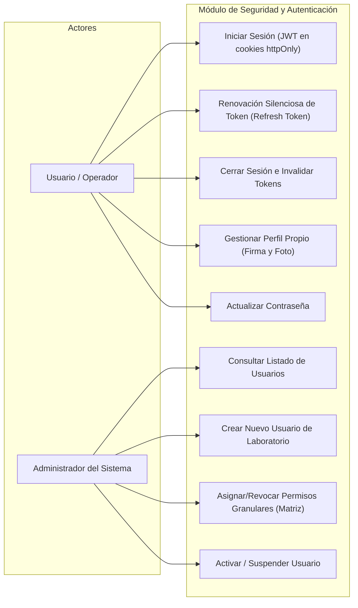
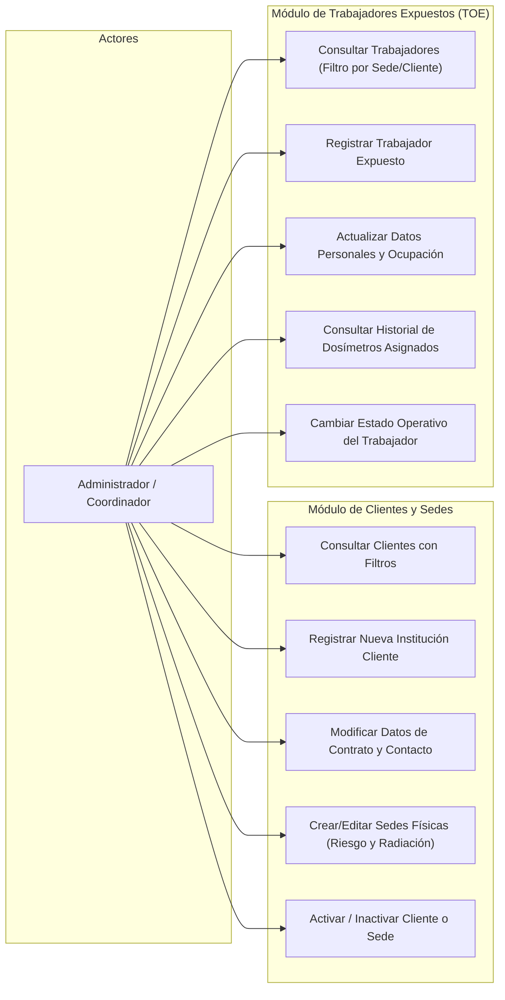
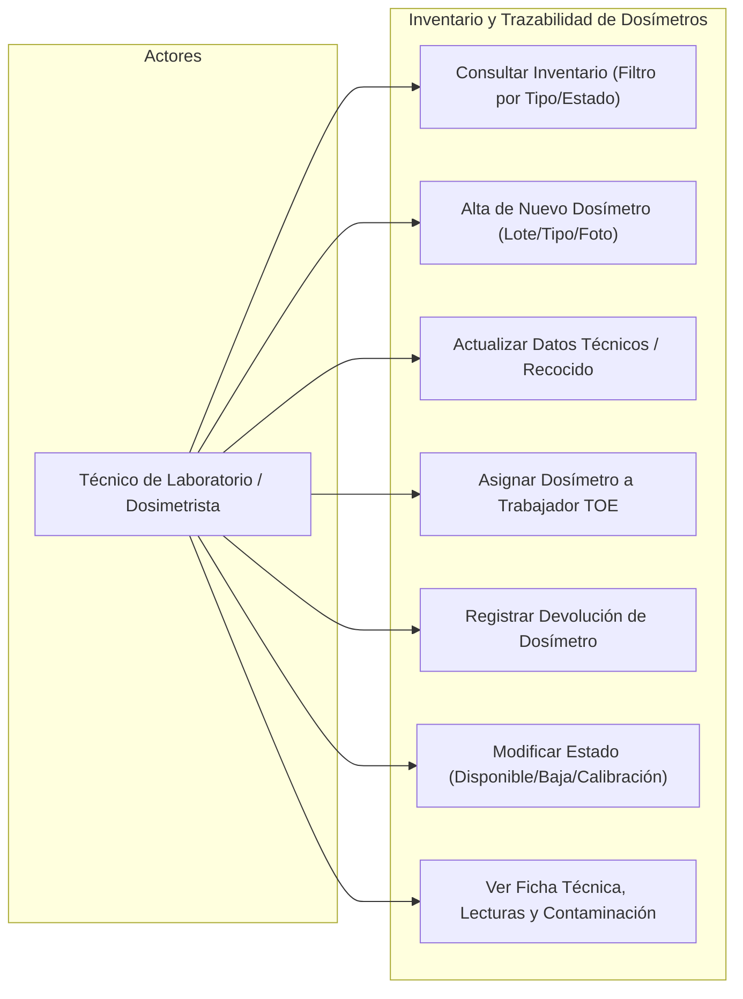
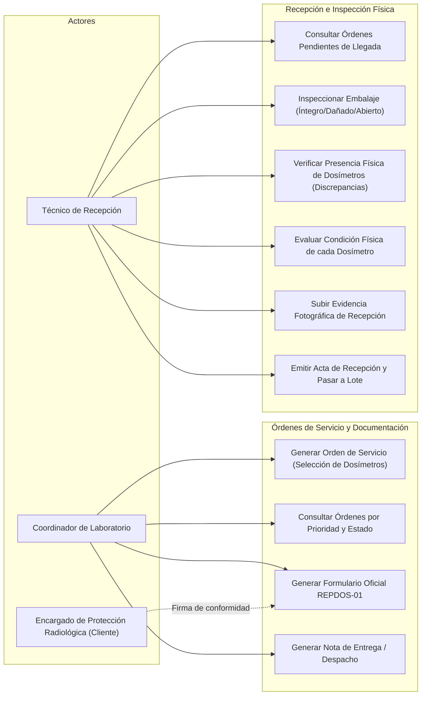
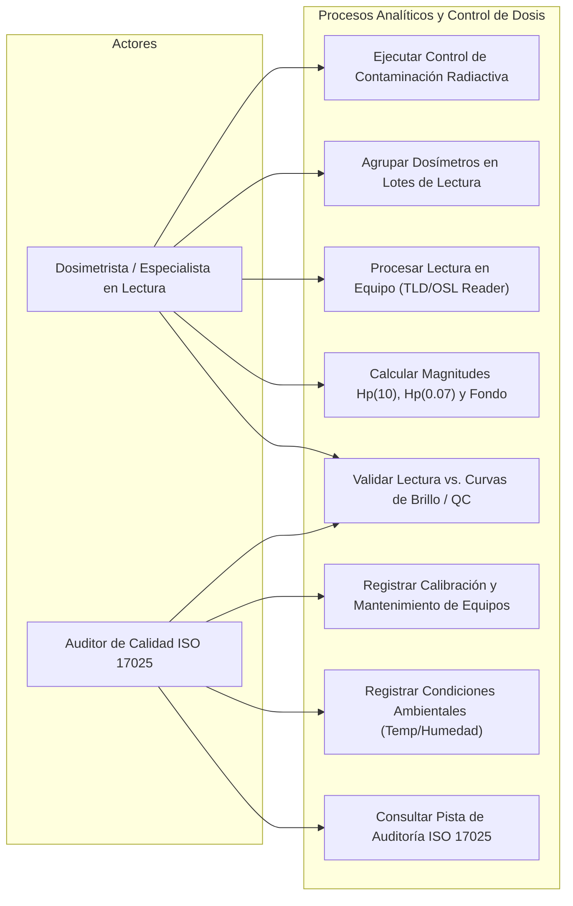
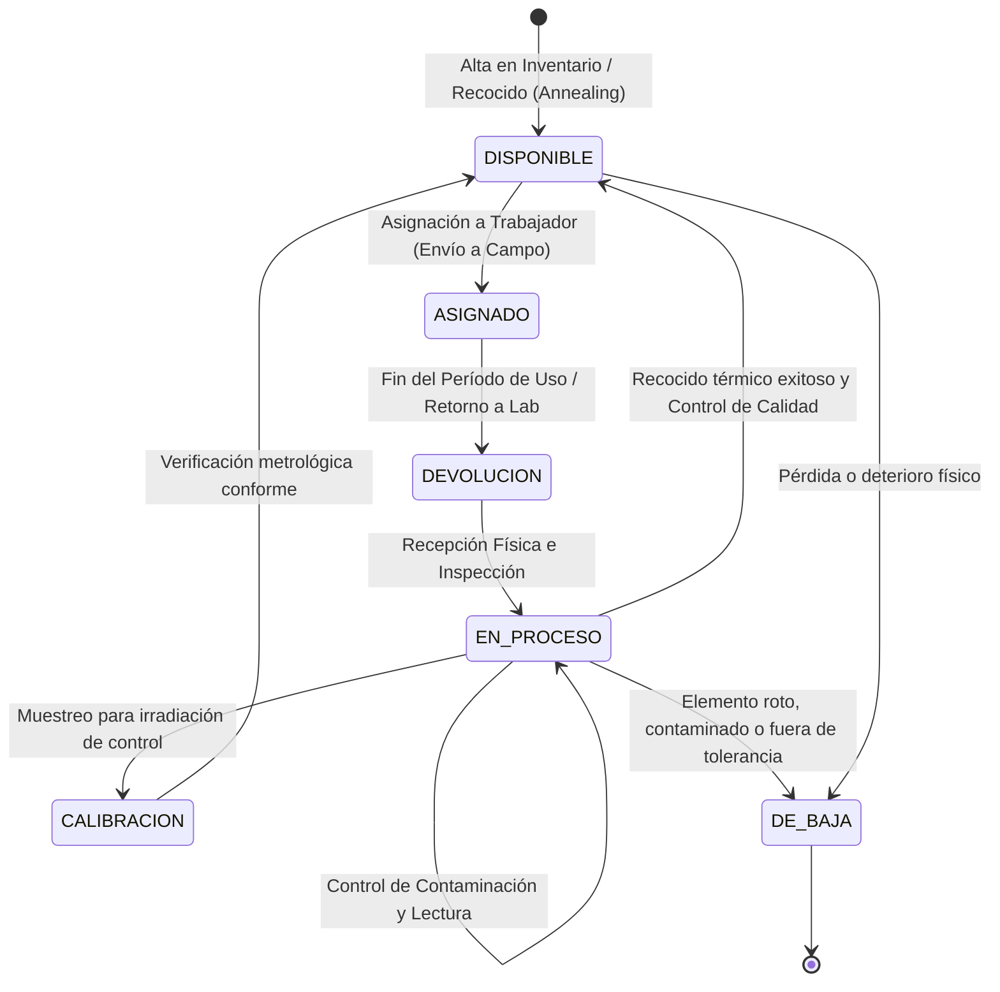
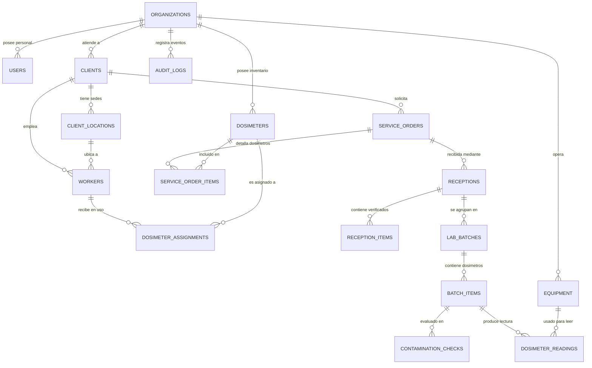

# DOSSIER TÉCNICO Y EJECUTIVO DEL SISTEMA DE DOSIMETRÍA ISO/IEC 17025
**Documento Maestro de Arquitectura, Dominio, Vistas y Casos de Uso**  
*Optimizado para procesamiento en Google NotebookLM, generación de presentaciones ejecutivas y capacitación técnica.*

---

## 1. INTRODUCCIÓN Y VISIÓN DEL SISTEMA

### 1.1 ¿Qué es el Sistema de Dosimetría?
El **Sistema de Control y Trazabilidad de Dosimetría Ocupacional** es una plataforma integral de grado corporativo desarrollada para laboratorios acreditados bajo la norma internacional **ISO/IEC 17025**.

Su misión principal es gestionar el ciclo de vida completo de los dosímetros (TLD - Termoluminiscencia, OSL - Luminiscencia Ópticamente Estimulada, etc.) utilizados por **Trabajadores Ocupacionalmente Expuestos (TOE)** en entornos con riesgo de radiaciones ionizantes (hospitales, clínicas de radiodiagnóstico, centrales e industrias con fuentes radiactivas, centros de medicina nuclear e investigación).

El sistema garantiza que cada milisievert ($mSv$) reportado cuente con una cadena de custodia ininterrumpida, desde el despacho del dosímetro hasta su lectura física en los equipos lectores del laboratorio, asegurando cumplimiento normativo, cálculo de incertidumbre y trazabilidad metrológica estricta.

### 1.2 Problemas Clave que Resuelve
1. **Pérdida de Trazabilidad Física:** Elimina el uso de hojas de cálculo aisladas donde no se conoce el paradero de los dosímetros ni su estado de uso en campo.
2. **Cumplimiento ISO/IEC 17025:** Automatiza registros de auditoría inviolables (`audit_logs`), controles de calibración y mantenimiento de equipos lectores, condiciones ambientales de laboratorio y chequeos de contaminación superficial previa a la lectura.
3. **Control Riguroso de Dosis Radiológica:** Permite calcular y monitorear magnitudes dosimétricas normalizadas:
   - **$Hp(10)$**: Dosis equivalente profunda en tejido blando (a 10 mm de profundidad).
   - **$Hp(0.07)$**: Dosis equivalente superficial en piel y extremidades (a 0.07 mm de profundidad).
   - **Resta de Dosis de Fondo (Background):** Corrección ambiental durante el transporte y almacenamiento.
4. **Seguridad y Confidencialidad Multi-Tenant:** Aislamiento estricto de los datos entre diferentes organizaciones y control granular de permisos por usuario.

---

## 2. ARQUITECTURA TÉCNICA Y SEGURIDAD

### 2.1 Stack Tecnológico Implementado

```
+-----------------------------------------------------------------------------+
|                                 FRONTEND                                    |
|   React 19 + TypeScript 6 + Tailwind CSS 4 + Vite 8 + React Router 7        |
+-----------------------------------------------------------------------------+
                                     │  (Cookies httpOnly: access_token)
                                     ▼
+-----------------------------------------------------------------------------+
|                                  BACKEND                                    |
|   NestJS 10 + Passport JWT + Throttler + Helmet + Class-Validator           |
|   Arquitectura Modular: Controllers -> Use-Cases -> Repositories/Services    |
+-----------------------------------------------------------------------------+
                                     │  (Supabase Service Role Key)
                                     ▼
+-----------------------------------------------------------------------------+
|                               BASE DE DATOS                                 |
|   PostgreSQL 17 en Supabase (15 Migraciones SQL)                            |
|   RLS Multi-tenant, Procedimientos Almacenados, Triggers de Auditoría       |
+-----------------------------------------------------------------------------+
```

### 2.2 Principios de Seguridad y Aislamiento de Datos
- **Arquitectura Zero Direct Access a la Base de Datos:** El frontend **nunca** se comunica directamente con Supabase/PostgreSQL. Toda comunicación pasa a través de la API NestJS (`/api/v1`).
- **Autenticación Robusta sin Almacenamiento en LocalStorage:** Las credenciales de sesión se gestionan mediante cookies seguras `httpOnly`, con tokens JWT de vida corta y mecanismo de rotación automática de `refresh_token` con hashing en base de datos.
- **Autorización Basada en Permisos Granulares:** A diferencia de sistemas basados únicamente en roles estáticos, este sistema evalúa permisos por par `módulo:acción` (ej. `dosimeters:create`, `service_orders:read`, `audit:read`). Los roles son informativos para la interfaz, pero la barrera de seguridad en backend la ejerce el guard `PermissionsGuard` con caché en memoria de 60 segundos (`PermissionsCacheService`).
- **Multi-Tenancy Inviolable:** Todas las consultas y mutaciones filtran obligatoriamente por el `organization_id` extraído criptográficamente del JWT del usuario autenticado, evitando cualquier posibilidad de escalamiento o fuga de información entre laboratorios o clientes.

---

## 3. CATÁLOGO COMPLETO DE DATOS PRESENTADOS EN EL FRONTEND

A continuación se desglosan con precisión todos los datos, campos, estados, filtros y componentes visuales que se presentan al usuario final en cada módulo de la aplicación web:

### 3.1 Módulo: Perfil de Usuario y Sesión
- **Datos Mostrados:**
  - Nombre completo y correo electrónico corporativo.
  - Organización asignada.
  - Roles asignados (ej. *Administrador de Laboratorio*, *Técnico de Laboratorio*, *Dosimetrista*, *Coordinador*, *Auditor*).
  - Contador de permisos activos en el sistema.
  - Perfil profesional extendido: Título académico / grado, Universidad de egreso, Documento de identidad personal, Teléfono de contacto, Fecha de nacimiento, Fecha de contratación laboral.
  - Enlace y previsualización de **Foto de perfil** y **Firma digitalizada** (utilizada para avalar reportes de laboratorio e informes de dosimetría).
- **Acciones:** Edición de perfil propio y cambio de contraseña con validación de complejidad.

### 3.2 Módulo: Clientes e Instituciones (`/clients` y `/clients/:id`)
- **Datos en la Vista de Listado:**
  - Código único de cliente/institución.
  - Nombre o Razón Social de la empresa/hospital.
  - Tipo de cliente (Badges de filtro: *Hospital*, *Clínica*, *Industria*, *Investigación*, *Gobierno*, *Otro*).
  - Nombre de la persona de contacto principal y correo electrónico.
  - Teléfono institucional.
  - Estado operativo: Badge verde (*Activo*) o gris (*Inactivo*).
  - Paginación dinámica y búsqueda reactiva con *debounce* por nombre, código o contacto.
- **Datos en el Detalle del Cliente (`/clients/:id`):**
  - **Ficha General:** Dirección fiscal, sitio web corporativo, fecha de inicio y vencimiento del contrato de servicio dosimétrico.
  - **Gestión de Sedes y Ubicaciones Físicas (`client_locations`):**
    - Código interno de sede.
    - Nombre del centro, edificio o departamento (ej. *Torre Médica - Rayos X*, *Pabellón Quirúrgico*, *Área Industrial NDT*).
    - Nombre de contacto responsable de la sede y teléfono directo.
    - **Tipo de Radiación Presente:** Rayos X, Gamma, Neutrones, Beta, Mixta u Otro.
    - **Nivel de Riesgo Radiológico:** Badges semaforizados: *Bajo* (verde), *Medio* (amarillo) y *Alto* (rojo).
    - Estado de la sede (Activar / Inactivar con modal de confirmación).
  - **Listado Embebido de Trabajadores Expuestos:** Vista compacta de todos los trabajadores asignados específicamente a ese cliente y sus distintas sedes.

### 3.3 Módulo: Trabajadores Ocupacionalmente Expuestos (`/workers`)
- **Datos en la Vista de Listado:**
  - Nombre completo del trabajador (TOE).
  - Documento de identidad (cédula o pasaporte).
  - Código de empleado interno de su empresa.
  - Institución cliente a la que pertenece y Sede física asignada.
  - Cargo u ocupación técnica (ej. *Radiólogo*, *Técnico en Radiología*, *Físico Médico*, *Enfermero de Hemodinámica*, *Operador de Ensayos No Destructivos*).
  - Estado del trabajador (*Activo* / *Inactivo*).
  - Filtros directos por Cliente y por Sede física.
- **Datos en la Ventana Modal de Detalle:**
  - Identificación completa (Documento y Código).
  - Datos personales (Sexo: *Masculino/Femenino/Otro*, Fecha de nacimiento, Teléfono, Correo electrónico).
  - Datos laborales (Ocupación, Fecha de inicio laboral, Institución y Sede).
  - **Historial Completo de Dosímetros Asignados:**
    - Identificador y número de serie del dosímetro.
    - Período de porte (Fecha de asignación y fecha de devolución).
    - Badge de estado de la asignación: *En campo* (activo) o *Devuelto* (cerrado).
    - Nombre del operador o responsable que registró la entrega/recepción y notas de campo.

### 3.4 Módulo: Inventario y Trazabilidad de Dosímetros (`/dosimeters` y `/dosimeters/:id`)
- **Datos en la Vista de Listado:**
  - **Número de Serie** (identificador físico impreso/grabado en el dosímetro).
  - Fabricante y Modelo técnico.
  - Código interno asignado por el laboratorio.
  - Tipo de dosímetro (TLD, OSL, etc.).
  - **Estado Operativo del Ciclo de Vida:** Badges distintivos:
    - `DISPONIBLE`: En almacén o calibrado, listo para ser asignado.
    - `ASIGNADO`: En poder de un trabajador o cliente en campo.
    - `EN_PROCESO`: En laboratorio para lectura, recocido o mantenimiento.
    - `DEVOLUCION`: Retornado por el cliente, pendiente de verificación.
    - `CALIBRACION`: Sometido a verificación metrológica en irradiador.
    - `DE_BAJA`: Retirado permanentemente del servicio por daño o fatiga.
  - **Condición Física Actual:** *Excelente*, *Bueno*, *Regular*, *Dañado*.
  - Filtros por texto libre, tipo de dosímetro, estado y condición física.
- **Datos en la Vista de Detalle (`/dosimeters/:id`):**
  - **Datos del Dispositivo Físico:**
    - Fotografía de alta resolución del dosímetro con enlace para ver en tamaño original.
    - Tipo y Tecnología de detección.
    - Fabricante, Modelo y Número de lote de fabricación.
    - Fecha de fabricación y Fecha de puesta en servicio en el laboratorio.
    - Período máximo de uso recomendado (días de porte).
    - Límite máximo de dosis medible ($mSv$).
    - Fecha del último tratamiento térmico o recocido (*Annealing*).
    - Indicador de reusabilidad (*Sí / No*) y notas técnicas.
  - **Panel de Asignación Actual:**
    - Si está en campo: Nombre del trabajador titular, Institución cliente, Sede, Fecha de entrega, Nombre del técnico responsable de la entrega y botón de acción directa **«Devolver»**.
    - Si está disponible: Botón de acción directa **«Asignar a Trabajador»**.
    - Selector rápido para actualizar estado operativo con bloqueos inteligentes (no permite marcar como disponible si tiene asignación activa sin devolver).
  - **Pestañas de Historial Integral:**
    1. **Pestaña «Historial de Asignaciones»:**
       - Línea de tiempo con cada trabajador receptor histórico, institución, sede, fechas de entrega/devolución, responsable y observaciones.
    2. **Pestaña «Lecturas de Dosis»:**
       - Tabla con fecha y hora exacta de lectura en el equipo.
       - Período de uso evaluado (Fecha inicio – Fecha fin).
       - Dosis física medida con su unidad ($mSv, \mu Sv$) e incertidumbre expandida calculada ($\pm U$).
       - Desglose de magnitudes normalizadas: **$Hp(10)$** (dosis profunda) y **$Hp(0.07)$** (dosis en piel).
       - Nombre y modelo del equipo lector utilizado.
       - Calificación de la lectura: *Válido* (verde), *Sospechoso* (amarillo) o *Inválido* (rojo).
    3. **Pestaña «Control de Contaminación»:**
       - Registro de inspección de contaminación radiactiva superficial antes de entrar a equipos lectores.
       - Fecha del chequeo, inspector responsable y equipo de monitoreo utilizado.
       - Resultado cualitativo: *Libre* (verde), *Contaminado leve* (amarillo), *Contaminado severo* (rojo).
       - Valor numérico medido con unidad de actividad superficial ($Bq/cm^2$ o $cpm$).
       - Observaciones de descontaminación o aislamiento.

### 3.5 Módulo: Órdenes de Servicio (`/service-orders`)
- **Datos en la Vista de Listado:**
  - Número correlativo oficial de orden de servicio (ej. `SO-2026-0001`).
  - Cliente solicitante.
  - Tipo de servicio requerido: *Lectura de dosis*, *Lectura y recarga*, *Mantenimiento*, *Calibración*.
  - Prioridad: Badges de atención: *Normal* (azul), *Urgente* (naranja), *Crítica* (rojo).
  - Fechas: Fecha de solicitud y Fecha límite de entrega comprometida (*Due Date*).
  - Estado de la orden: *Borrador*, *Pendiente*, *En proceso*, *Completada*, *Cancelada*.
- **Asistente de Creación de Orden (`/service-orders/new`):**
  - Selector de cliente activo (carga automáticamente sus dosímetros asignados).
  - Selección dinámica de dosímetros a procesar: Permite seleccionar desde la lista de dosímetros en posesión del cliente o buscar por número de serie.
  - Definición de acción requerida por cada dosímetro individual: *Lectura*, *Limpieza*, *Recarga*, *Inspección*.
  - Parámetros de servicio, prioridad, fechas y observaciones especiales.
- **Generación y Previsualización de Documentos Oficiales:**
  - **Formulario REPDOS-01 (Entrega y Recibo de Dosímetros a Clientes):**
    - Identidad corporativa oficial: *Horacio Icaza y Cía., S.A. / Casa del Médico*.
    - Datos del cliente, código de institución, número de orden y lote de dosímetros.
    - Cuadrícula con lista de dosímetros entregados/recibidos, trabajador asociado y acción requerida.
    - Parámetros de control radiológico: Nivel de radiación de fondo ambiental registrado ($0.12\ \mu Sv/h$), nivel de contaminación superficial ($< 0.05\ Bq/cm^2$).
    - Firmas formales: Firma del responsable del laboratorio y firma del encargado de protección radiológica del cliente.
    - Modo de impresión optimizado para papel o PDF conforme a auditoría.
  - **Nota de Entrega / Remisión de Dosímetros:**
    - Documento de despacho formal que acompaña el envío físico de dosímetros preparados y calibrados hacia las instalaciones del cliente.

### 3.6 Módulo: Recepción Física e Inspección en Laboratorio (`/receptions`)
- **Datos en la Vista de Listado:**
  - Código único de recepción (ej. `REC-2026-0001`).
  - Número de orden de servicio vinculada.
  - Cliente y fecha de ingreso físico al laboratorio.
  - Condición general del paquete/embalaje: *Íntegro*, *Dañado*, *Abierto*, *Húmedo*.
  - Nombre del técnico de recepción responsable.
- **Proceso de Inspección en la Creación de Recepción (`/receptions/new`):**
  - Selector de órdenes de servicio en estado *Pendiente*.
  - Al seleccionar una orden, el sistema precarga todos los dosímetros que el cliente declaró enviar.
  - **Control de Discrepancias:** Casilla de verificación para marcar los dosímetros que realmente llegaron en el paquete vs. los declarados ausentes.
  - **Inspección Física Individual:** Condición de cada dosímetro recibido (*Íntegro*, *Roto*, *Filtro dañado*, *Sin etiqueta*, *Humedecido*).
  - **Carga de Evidencia Fotográfica:** Módulo de subida de imágenes con previsualización para registrar fotográficamente el estado del empaque o dosímetros defectuosos como prueba no repudiable ante reclamos o auditorías ISO 17025.

### 3.7 Módulo: Administración de Usuarios y Permisos (`/users` y `/users/:id`)
- **Datos en la Vista de Listado:**
  - Nombre completo, email, organización y roles informativos.
  - Estado del usuario (*Activo/Inactivo*).
- **Detalle y Matriz de Permisos (`/users/:id`):**
  - Datos profesionales del empleado de laboratorio.
  - **Matriz Interactiva de Permisos Granulares:**
    - Cuadrículas organizadas por los 12 módulos del sistema (`users`, `clients`, `workers`, `dosimeters`, `assignments`, `service_orders`, `receptions`, `lab_process`, `readings`, `reports`, `equipment`, `audit`).
    - Casillas de verificación para conceder o revocar acciones en tiempo real (`create`, `read`, `update`, `delete`), reflejando instantáneamente el principio de menor privilegio.

---

## 4. DIAGRAMAS DE CASOS DE USO DEL SISTEMA

Los siguientes diagramas modelan formalmente las interacciones entre los actores del sistema y los casos de uso implementados y proyectados:

### 4.1 Caso de Uso 1: Gestión de Identidad, Seguridad y Permisos Granulares



---

### 4.2 Caso de Uso 2: Gestión de Instituciones Clientes, Sedes y Trabajadores (TOE)



---

### 4.3 Caso de Uso 3: Inventario, Asignación y Ciclo de Vida del Dosímetro



---

### 4.4 Caso de Uso 4: Órdenes de Servicio, Emisión REPDOS-01 y Recepción ISO 17025



---

### 4.5 Caso de Uso 5: Procesos de Laboratorio, Lectura de Dosis y Control de Calidad



---

## 5. INFORMACIÓN CLAVE ADICIONAL PARA ENTENDER EL SISTEMA

Para comprender la totalidad del sistema y su rigor normativo, se deben tener en cuenta los siguientes cuatro pilares conceptuales y operativos:

### 5.1 El Ciclo de Vida del Dosímetro y su Máquina de Estados

El dosímetro es un activo reutilizable y controlado del laboratorio. Su estado evoluciona de forma estrictamente controlada:



### 5.2 Decisión de Diseño Fundamental en la Base de Datos
- **¿Por qué la tabla `dosimeters` NO tiene clave foránea directa (`FK`) a la tabla `clients`?**  
  En un laboratorio dosimétrico acreditado, los dosímetros pertenecen al laboratorio, no al cliente. Un mismo dosímetro físico puede monitorear a un trabajador de un Hospital en enero, ser devuelto, borrado térmicamente (recocido), verificado y asignado a un trabajador de una Industria metalúrgica en marzo.  
  Por ende, la relación entre un dosímetro y un cliente se modela de forma temporal y rastreable mediante `dosimeter_assignments` (asignación directa a un trabajador) y `service_order_items` (solicitud contractual de procesamiento).

### 5.3 Fundamentos Metrológicos y Normativa ISO/IEC 17025
Para que los resultados tengan validez legal y regulatoria ante ministerios de salud y comisiones nucleares:
1. **Dosis Equivalente Personal Profunda $Hp(10)$:** Estima el riesgo para órganos internos frente a radiaciones fuertemente penetrantes (Rayos X de alta energía, radiación gamma).
2. **Dosis Equivalente Personal Superficial $Hp(0.07)$:** Estima el impacto biológico sobre la piel, manos o cristalino.
3. **Dosis de Fondo (Background):** La radiación natural del entorno debe restarse del valor bruto medido en el cristal detector para no sobrestimar la dosis laboral del trabajador.
4. **Incertidumbre de Medición:** Toda lectura debe registrarse acompañada del cálculo de su incertidumbre combinada y expandida ($k=2$, nivel de confianza del 95%), considerando variaciones del lector, estabilidad térmica y lote de calibración.

### 5.4 Modelo Entidad-Relación Consolidado (Esquema Lógico)



---

## 6. ESTADO DE DESARROLLO ACTUAL Y ROADMAP

| Módulo / Componente | Capa Frontend | Capa Backend | Capa Base de Datos | Estado General |
|---|:---:|:---:|:---:|:---:|
| **Autenticación y Sesión Segura** | Implementado | Implementado | Implementado | **100% Funcional** |
| **Usuarios y Permisos Granulares** | Implementado | Implementado | Implementado | **100% Funcional** |
| **Clientes y Sedes Físicas** | Implementado | Implementado | Implementado | **100% Funcional** |
| **Trabajadores Expuestos (TOE)** | Implementado | Implementado | Implementado | **100% Funcional** |
| **Inventario y Ficha de Dosímetros** | Implementado | Implementado | Implementado | **100% Funcional** |
| **Órdenes de Servicio y REPDOS-01** | Implementado | Implementado | Implementado | **100% Funcional** |
| **Recepción e Inspección ISO 17025** | Implementado | Implementado | Implementado | **100% Funcional** |
| **Lotes de Laboratorio y Lecturas** | Vistas Diseñadas | Endpoints en Proceso | Schema Implementado | **70% (Fase Final)** |
| **Gestión de Equipos y Calibración** | Pendiente | Pendiente | Schema Implementado | **Fase Siguiente** |
| **Reportes Oficiales y Auditoría ISO** | Pendiente | Pendiente | Schema Implementado | **Fase Siguiente** |

---

## 7. INSTRUCCIONES PARA GENERAR PRESENTACIONES EN NOTEBOOKLM

Al cargar este archivo en [Google NotebookLM](https://notebooklm.google.com/), utiliza los siguientes *prompts* recomendados para extraer el máximo provecho del sistema:

1. **Para crear una Presentación Ejecutiva en Diapositivas:**
   > *"Actúa como un arquitecto de software y consultor de calidad ISO 17025. Utilizando el dossier adjunto, genera un guion detallado de 10 diapositivas para presentar a la junta directiva y clientes. Cada diapositiva debe incluir: Título, Mensaje clave, Puntos a tratar y Datos que se muestran en pantalla."*

2. **Para generar el Audio Overview (Podcast explicativo de 2 personas):**
   > *"Haz clic en el botón 'Generar Audio Overview' en NotebookLM. Los dos presentadores explicarán de forma natural y conversacional cómo el sistema protege la salud de los trabajadores expuestos a radiación y garantiza que el laboratorio cumpla con la norma ISO 17025."*

3. **Para preparar una sesión de Preguntas y Respuestas (Q&A) Técnicas:**
   > *"¿Cuáles son los mecanismos de seguridad que impiden que un cliente acceda a los datos de otro? Explica el ciclo de vida del dosímetro desde que sale disponible hasta que se lee la dosis profunda Hp(10)."*
